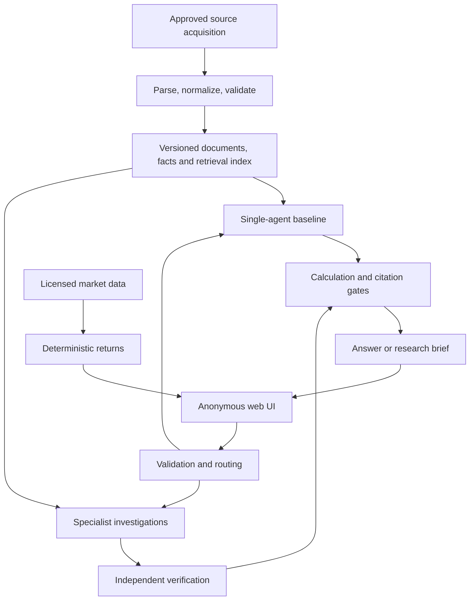

# NSE Financial Research Assistant — Project Plan

**Status:** Implementation authorized. See [README.md](README.md) for the learning sequence and current progress.

**Updated:** 12 November 2026, Asia/Kolkata.

**Purpose:** A production-quality portfolio project demonstrating evidence-grounded financial research, meaningful multi-agent orchestration, and reliable hosted delivery.

## 1. Confirmed decisions and working assumptions

### Confirmed by the project owner

- Sector: Indian IT services.
- Companies: TCS, Infosys, HCLTech, Wipro, and Tech Mahindra.
- Initial financial snapshot: FY2024–25 and FY2025–26, covering April 2024 through March 2026.
- Hosted experience: an anonymous public demo, subject to actual data and content rights.
- Defer investor sentiment and analyst consensus. Provider-native rating granularity is accepted if this feature is revisited; no rating UI is required now.
- No external finance-domain review is required for this sample project.
- Public release must include all remaining in-scope features using real data for every visitor; no synthetic-data or deliberately restricted demo mode.
- No visitor question quotas or demo usage caps. Operational execution bounds remain part of reliable agent orchestration.
- The site may be shut down after the job search; include a documented teardown process.
- Python is acceptable; there is no strong language constraint.
- Available development time is flexible. Learning current AI engineering practices takes priority; start small and retain a path to scale.
- Budget is flexible. Monitor and report costs without an automatic daily/monthly demo spend cutoff.
- Implementation is underway in incremental learning steps. Public launch depends on the release criteria below.

### Latest scope decision

Sentiment is deferred. The current product has financial performance, business outlook, and historical stock performance. No buy/hold/sell recommendation feature is included. The project owner has waived external domain review; testing and developer source checks remain, with no claim of independent financial validation. Full public release depends on real-data readiness and permitted public use.

### Working assumptions

- Use Python for backend/AI and TypeScript for the browser UI.
- Begin with Infosys as the vertical slice, then expand to all five companies.
- Use fixed, versioned data snapshots before implementing ongoing updates.
- Fetch earlier comparative evidence where necessary for year-over-year calculations in the first covered quarters; the main reporting window remains eight quarters.
- Keep public source documents, licensed data, and evaluation answer keys out of the public source-code repository unless redistribution is explicitly permitted.
- Treat effort estimates as planning ranges and recalibrate after the first company.

## 2. Product promise and target user

Help a financially curious professional understand a company's financial performance and business outlook through verifiable evidence from filings, earnings materials, and historical data.

The strongest portfolio claim is: **a reproducible research system that measures where agents improve results and exposes uncertainty and limitations.**

Interviewers are a secondary audience. Provide an engineering demonstration with sanitized execution traces, evaluation results, architecture decisions, and cost/latency comparisons.

Maintain three distinct outputs:

| Output | Meaning | Inputs |
|---|---|---|
| Financial performance | What the company reported and what changed | Statements, tables, calculations |
| Business outlook | Evidence-based assessment of operational direction | Filings, management statements, risks, counterevidence |
| Stock performance | Historical market returns and volume | Licensed prices, corporate actions, benchmark histories |

Price movements do not establish causation, validate management claims, or determine business outlook. None of these outputs should silently substitute for another.

## 3. Initial scope and user experience

### Core capabilities

1. Answer company-specific questions with precise citations.
2. Compare reporting periods and explain supported changes.
3. Assess management claims as supported, partially supported, contradicted, or not verifiable.
4. Identify strengths, risks, contradictory evidence, and missing information.
5. Produce a structured research brief with an improving, stable, deteriorating, or mixed business-outlook assessment when evidence is sufficient.
6. Explicitly abstain from an overall outlook when evidence is insufficient; mixed is not a synonym for missing evidence.
7. Show historical stock performance against Nifty 50 and Nifty IT using consistent conventions.

### UI

- **Ask:** company selector, supported snapshot, question, cited answer, calculation details.
- **Research brief:** operating performance, management claims, strengths, risks, contradictions, missing evidence, outlook, and assessment horizon.
- **Evidence:** passages, tables, page references, original-source links, and source-page rendering where permitted.
- **Market performance:** stock and benchmark charts, volume, return method, corporate actions, and freshness.
- **Coverage:** expected versus available documents, missing periods, last checked, last successful ingestion, and latest covered period.

Default the entire experience to the historical snapshot. Proposed historical assessment cutoff: a verified common date after the included FY2025–26 annual reports were published. Record actual publication dates; a March 2026 reporting period does not imply that its annual report was available in March.

Anonymous browsing requires no login. All visitors can use live Q&A and generate briefs on the real, versioned dataset, with no visitor question allowance, paywall, or automatic demo spend cutoff. Evidence-versioned caching is allowed for performance, but is not a substitute for live capabilities. Queue work within available capacity and expose delays/failures honestly. Per-request tool-call/time bounds prevent runaway execution; these are not visitor quotas. Do not promise persistent personal chat history in the first public release.

### Demo scenarios

| Scenario | Demonstrated capability |
|---|---|
| How did revenue and operating margin change year over year? | Table retrieval, scope matching, deterministic arithmetic |
| Management says demand improved; what supports or challenges that? | Adaptive investigations and independent counterevidence |
| Profit increased; did cash generation improve too? | Cross-statement reasoning and period compatibility |
| Compare stock performance with Nifty 50 and Nifty IT | Return conventions and corporate actions |
| What was revenue from an undisclosed customer? | Appropriate abstention |
| Re-run a brief with a revised filing | Versioning, changed-evidence tracking, reproducibility |

### Proposed measurable acceptance criteria

| Measure | Initial target |
|---|---|
| Citation integrity | Every citation resolves to the correct document version and location |
| Numerical accuracy | At least 95% on reviewed numerical questions; every calculated figure has tool provenance |
| Factual support | At least 95% of sampled substantive factual claims supported by evidence |
| Retrieval | At least 90% evidence recall@10 on annotated cases |
| Abstention | At least 90% correct abstention on unanswerable cases; report false abstentions separately |
| Scope correctness | No company, period, currency, or consolidated/standalone mix-ups in release-blocking fixtures |
| Time integrity | No evidence published after a request's as-of cutoff used in historical answers |
| Performance | Warm p95 Q&A at most 20 seconds; asynchronous briefs at most 120 seconds at five concurrent users |
| Failure behavior | No silent partial or falsely verified reports |
| Rights | Every enabled public data/display feature has documented permission or other reviewed basis |

These are proposed targets, not established capabilities. Publish denominators, evaluation versions, and uncertainty with scores.

## 4. Deferred sentiment feature

Investor sentiment, analyst consensus, and buy/hold/sell displays are deferred by the project owner on 12 November 2026. Provider-native rating scales are acceptable if the feature is revisited. No sentiment provider, agent, evaluation suite, licensing purchase, or release milestone is needed now. This does not change the improving/stable/deteriorating/mixed business-outlook assessment.

## 5. Data-source feasibility

### Company sources

Public checks found official investor materials for all five proposed companies:

- [TCS investor relations](https://www.tcs.com/investor-relations)
- [Infosys investor relations](https://www.infosys.com/investors/)
- [HCLTech financial results](https://www.hcltech.com/investor-relations/financial-results)
- [Wipro investor materials](https://www.wipro.com/investors/)
- [Tech Mahindra quarterly earnings](https://www.techmahindra.com/investors/quarterly-earnings/)

These checks establish promising availability, not complete eight-quarter coverage or reuse permission. Audit each required document and its publication date.

| Data | Preferred source | Validation |
|---|---|---|
| Financial statements | Company IR; exchange filings for corroboration | Accounting basis, periods, amendments, storage/extraction rights |
| Presentations and transcripts | Official company publications | Complete quarters, speaker attribution, publication date, quotation/display rights |
| Daily close and volume | Licensed historical-data provider | NSE coverage, corrections, adjustment semantics, hosted-display rights |
| Corporate actions | Provider plus official announcements | Splits, bonuses, dividends, ex-dates, corrections |
| Benchmark histories | Licensed Nifty data | Nifty 50 and Nifty IT; price and total-return variants |

IT services offers shared operating measures and substantial investor materials, while avoiding some bank/insurer accounting complexity. Business mix, profitability definitions, constant-currency methods, and bookings still require company-specific treatment.

### Licensing findings and selection gate

Public availability is not a reuse license. Infosys's terms restrict copying, distribution, and mirroring. Review the basis for document acquisition, retained storage, third-party model processing, excerpts, and hosted PDF pages. Original-source links do not automatically resolve ingestion or reuse rights. [Infosys terms](https://www.infosys.com/terms-of-use.html)

NSE's policy makes redistribution subject to the applicable agreement. Its domestic tariff effective April 2026 lists Capital Market EOD data at INR 100,000 annually per site/per medium. This is a reference tariff, not a complete quote for this project or for index rights. [NSE policy](https://www.nseindia.com/static/market-data/nse-data-policy), [tariff](https://nsearchives.nseindia.com/web/mediaattachment/2026-04/Download_Pricing_file_-_Domestic_clients_20260424122229.pdf)

Kite offers historical daily OHLCV and publishes a paid API price of INR 500/month per key. Access does not establish public-display rights. EODHD distinguishes personal subscriptions from commercial licensing; verify actual NSE/index coverage before considering it. [Kite historical API](https://www.kite.trade/docs/connect/v3/historical/), [Kite pricing](https://support.zerodha.com/category/trading-and-markets/general-kite/kite-api/articles/historical-data-and-live-market-data-payment-plan), [EODHD licensing](https://eodhd.com/financial-apis/commercial-vs-personal-license-use)

NSE Indices requires licensing for use or distribution of index data. Nifty IT has a total-return variant; official historical reports expose price and total-return histories. [Index terms](https://www.niftyindices.com/disclaimer), [Nifty IT factsheet](https://www.niftyindices.com/Factsheet/ind_nifty_it.pdf), [historical reports](https://www.niftyindices.com/reports)

Before selecting a provider, obtain sample data and written confirmation covering the actual anonymous demo: five securities, two indices, historical backfill, updates, storage, derived returns, charts, screenshots, attribution, user limits, and API limits. Test known corporate actions, missing trading days, and corrections.

Maintain a rights register with source, permitted operations, evidence of permission, restrictions, renewal dates, and feature flags. Resolve permissions for every in-scope feature before the full public launch; do not substitute synthetic data or present a partial launch as complete. Use another permitted real-data source or hold public launch if necessary. Authentication alone is not a licensing workaround.

## 6. Architecture and end-to-end flow

Use a modular application with API and background-worker processes. Logical agents do not require separate microservices.

### Comparison configurations

1. Fixed retrieval, calculation, and answer workflow: simple RAG control.
2. One research agent with the same tools: strong single-agent baseline.
3. Specialist investigations and independent verification: candidate multi-agent design.

Use the same corpus, tools, questions, and comparable model tiers. Include a single-agent run with comparable total token budget to separate architectural value from additional computation.

### Agent responsibilities

| Agent | Adaptive responsibility | Permissions |
|---|---|---|
| Financial investigator | Select metrics, periods, reconciliations, and follow-up checks | Read filings/facts; invoke typed calculators |
| Management-claims investigator | Extract testable claims, check definitions/horizons, investigate qualifications | Read transcripts, presentations, filings; invoke calculators |
| Independent verifier | Search contrary evidence, challenge scope errors and unsupported conclusions | Read evidence and independently invoke calculators |

First investigators work independently before seeing one another's conclusions. The verifier performs fresh retrieval rather than merely agreeing with their prose. This reduces anchoring but does not make model errors independent.

Outputs: claim, supporting evidence, counterevidence, calculations, limitations, proposed conclusion. Agents choose subsequent investigative actions from evidence; parsers, arithmetic, retries, and report formatting are ordinary workflows.

### Deterministic responsibilities

- Identity/session handling, company and period resolution.
- Source acquisition, deduplication, versioning, indexing.
- Tool permissions and typed calculations.
- Market returns and corporate-action handling.
- Budgets, cancellation, retries, queue leases, checkpoint persistence.
- Citation resolution, structured-output validation, final rendering.

### Shared state

Store request ID, company ID, as-of cutoff, corpus version, requested periods, plan, evidence/fact/calculation references, claims, disagreements, remaining budgets, failures, and execution status. Agents append typed findings; they do not silently overwrite one another. Keep references rather than copying full documents into every checkpoint. Separate session state from authoritative financial facts.

### Execution limits and recovery

- At most three investigative agents.
- At most six tool calls per agent and one bounded follow-up round, all within a request-wide ceiling.
- Enforce token, dollar, and wall-clock limits before each call.
- At most two retries for transient errors, with backoff/jitter; one structured-output repair.
- Checkpoint completed steps; idempotency keys prevent duplicate side effects on resume.
- Cancellation, timeouts, expired leases, and dead-letter jobs are explicit states.
- Exhausted budgets produce a labeled partial answer or abstention.
- A failed or skipped verifier never produces a “verified” badge.

## 7. Recommended technology stack

| Layer | Recommendation | Reason / alternative |
|---|---|---|
| Backend | Python, FastAPI, Pydantic | Typed contracts and ML/document ecosystem |
| Orchestration | LangGraph | Explicit state/checkpoints; plain Python workflow as baseline |
| UI | React, TypeScript, Vite | Chat, evidence panels, charts without unnecessary SSR |
| Database | PostgreSQL, pgvector, full-text search | Facts, provenance, workflow state, retrieval in one system |
| Parsing | Docling plus targeted OCR fallback | Benchmark layout/table fidelity on actual filings |
| Calculations | Decimal, SQL, typed Python functions | Reproducible arithmetic; no arbitrary generated code |
| Objects | S3-compatible storage | Versioned originals/derived artifacts where permitted |
| Jobs | PostgreSQL-backed queue | Leases, idempotency, retries without immediate Redis dependency |
| Observability | OpenTelemetry plus LLM trace/evaluation viewer | Correlate tools, evidence, costs, and infrastructure |
| Testing | pytest, property-based tests, Playwright | Arithmetic invariants, workflows, source navigation |
| Delivery | Docker, GitHub Actions, managed containers | Small initial deployment, credible CI/CD |

LangGraph persistence supports checkpointed execution; application idempotency remains necessary. [Documentation](https://docs.langchain.com/oss/python/langgraph/persistence)

pgvector supports hybrid retrieval with PostgreSQL full-text search, rank fusion, and reranking. Standard PostgreSQL full-text ranking is not BM25. Introduce a separate search engine only when measured retrieval needs justify it. [pgvector](https://github.com/pgvector/pgvector)

Docling is a candidate, not an accuracy guarantee. [Docling](https://docling-project.github.io/docling/)

Run a model bake-off during implementation: economical tool-capable model for ordinary Q&A; stronger model for difficult investigation/verification. Select against project evaluations, pin versions where possible, and record provider/model parameters. Do not choose solely by recency or leaderboard position.

Learning priorities: durable execution, structured tools, independent verification, hybrid retrieval, evaluation-driven routing, tracing, prompt-injection resistance, caching, and cost controls. MCP can be a later interoperability exercise after internal tool contracts stabilize. Consider Temporal, dedicated retrieval infrastructure, or additional services only when concrete operating needs emerge.

## 8. Ingestion, tables, retrieval, calculations, and provenance

### Acquisition and parsing

For every document store company identifier, URL, publication time, reporting period, document type, accounting basis, content hash, acquisition time, rights status, and parser version. Keep immutable originals and extraction artifacts where permitted. Track PDF page index separately from printed page label.

Narrative chunks retain headings, page coordinates, and source identity. Table extraction retains row/column hierarchies, merged headers, footnotes, negatives in parentheses, blank/missing values, and scale/currency annotations. Low-confidence extraction enters review, not silent production use.

### Fact representation

Each financial fact includes metric, raw label, value, currency, scale, start/end dates, instant-or-duration type, consolidated-or-standalone scope, accounting basis, source cell, revision, extraction status, and review status.

Start with about 10–15 measures: revenue, operating profit/margin, net profit, operating cash flow, capital expenditure, cash, debt, receivables, and disclosed constant-currency growth, bookings, headcount, and attrition where definitions are usable.

Reconcile extracted facts with statements and reviewed samples. Preserve company-specific measures rather than forcing false comparability.

### Finance learning notes

| Concept | Meaning and consequence |
|---|---|
| Consolidated / standalone | Group results / parent-only results; do not combine |
| Revenue / profit / cash flow | Sales / accounting earnings / cash generated; improvement in one does not prove improvement in others |
| YoY / QoQ | Same quarter last year / preceding quarter; seasonal effects differ |
| Margin / growth | Profit divided by revenue / change over time |
| Basis points | 20% to 21% is a 100-basis-point increase |
| Constant currency | Company-defined removal of exchange-rate effects; retain methodology |
| Bookings / revenue | Contract awards / revenue recognized; bookings are not guaranteed immediate revenue |
| Reported / adjusted | Published accounting measure / measure excluding specified items |
| Free cash flow | Commonly operating cash flow less capital expenditure; define exactly and preserve company alternatives |

Important traps: crore versus million, INR versus USD, quarterly versus year-to-date values, annual-only cash-flow statements, revised comparatives, Q4 derived from annual minus nine-month figures, and non-comparable adjusted margins.

Do not invent quarterly cash flow from annual totals. Mark derived Q4 values and cite both inputs. Maintain original and restated facts; select versions using explicit knowledge/publication cutoffs.

### Retrieval

Resolve company, scope, period, and as-of filters before retrieval. Combine lexical and semantic candidates with reciprocal rank fusion, rerank, and supply table context plus headers/footnotes. Use structured facts for numerical questions and narrative evidence for explanations.

Initial tuning point: approximately 30 lexical and 30 semantic candidates, deduplicated and reranked to 8–12 evidence items. Tune only on the development set. Preserve contradictory passages and distinguish management statements from reported facts.

### Calculations and citation provenance

Typed tools accept metric identifiers and fact IDs, not arbitrary model-generated Python or SQL. Record formula version, input values/units, source IDs, rounding, output, and calculation ID. Handle zero/negative denominators explicitly.

Every calculated statement links to its calculation and original evidence. Citation existence can be checked mechanically; whether a passage actually supports a claim also needs semantic and human evaluation.

### Stock returns

- Preserve raw close/volume, corporate actions, provider revisions, and adjustment factors.
- Avoid double adjustments; document what the provider already adjusted.
- Compare price returns to price indices, or total returns to total-return indices.
- Begin with split/bonus-adjusted price returns if complete dividend treatment cannot be validated.
- Use common trading dates and rebasing date; label missing data instead of silent forward-filling.
- Retain raw volume; document any split-adjusted volume separately.
- Do not invent volume for indices or guess complex corporate-action factors.
- Explain that historical adjusted series can change after corporate actions or provider corrections; persist snapshots for reproducibility.

Total return includes dividends as well as price movement. [NSE explanation](https://www.nseindia.com/static/products-services/indices-total-returns-index)

### Business-outlook rubric

Assess demand, profitability, cash conversion, and execution risks. Each dimension has supporting evidence, counterevidence, direction, and limitations. Use improving/stable/deteriorating/mixed only when evidence is sufficient; otherwise abstain. Proposed horizon: next two to four quarters, clearly identified as an evidence-based assessment, not a validated prediction. Stock returns are excluded from this rubric's scoring inputs.

## 9. Evaluation and validation limitations

### FinanceBench

The official public release provides 150 annotated examples with answers/evidence and source PDFs. It is a sample of a larger benchmark. The official Hugging Face card declares CC BY-NC 4.0. Preserve attribution and verify intended usage; do not assume unrestricted commercial use or that the dataset license resolves every underlying document's rights. [Repository](https://github.com/patronus-ai/financebench), [dataset card](https://huggingface.co/datasets/PatronusAI/financebench)

Use it for foundational financial QA, calculations, retrieval, and citations. It does not validate NSE research or business outlook. Public benchmark exposure in model training limits claims of unseen generalization. Available documents alone are not a ground-truth QA dataset.

### NSE evaluation set

Initial target: 120 developer-checked QA cases plus approximately 15 developer-assessed briefs. In this plan, reviewed cases mean developer checks against sources, not independent finance-expert approval. Subjective judgments remain provisional.

| QA category | Count |
|---|---:|
| Numerical extraction/calculation | 30 |
| Period comparisons | 25 |
| Management claims and contradictory evidence | 25 |
| Missing information and abstention | 20 |
| Units, restatements, scope, date traps | 20 |

Each record contains expected facts/answer, acceptable alternatives, evidence locations, calculation method, numerical tolerance, as-of cutoff, and reviewer notes. Briefs need rubrics rather than a forced unique outlook label; more than one interpretation can be defensible.

### Leakage prevention

- Separate development and locked test sets by company-period and question families.
- Do not split trivial paraphrases or the same calculation across development/test.
- Keep answer keys, reviewer notes, and benchmark responses out of retrieval.
- Open-book test source documents may be indexed; gold answers may not.
- Record corpus, prompt, model, tool, and evaluation versions.
- Test no-look-ahead behavior explicitly, including restatements and late-published filings.

### Layered measurements

Evaluate extraction, evidence retrieval, arithmetic, factual answers, citation support, abstention, brief quality, and operational behavior separately. Use LLM judges for calibrated triage, not final authority. Conduct paired baseline-versus-agent comparisons, equal-budget controls, and repeated stochastic runs.

Proposed multi-agent gate: at least a five-percentage-point improvement on complex cases or meaningful reduction in unsupported claims, within an agreed cost/latency envelope. Publish sample sizes and uncertainty. If agents do not help, route selectively or keep the baseline as default.

### Finance learning and validation without external reviewers

External finance-domain review is not required and is not a launch gate. Learn through original statements, a documented metric dictionary, worked examples, and independent recalculation. Build expected answers directly from cited statements before comparing generated outputs; manually check source scope, units, dates, and footnotes. Log disputed cases rather than force a gold label.

Use deterministic arithmetic and invariant tests, retrieval/citation checks, FinanceBench reference answers, and developer source audits. LLM judges and verifier agents can flag issues but are not independent domain experts. Report numerical/source-check results separately from subjective brief scores. Business-outlook assessments are experimental and have not been independently validated by a finance professional; do not claim expert-reviewed financial accuracy. This limitation does not block the sample project release.

## 10. Security, public-demo reliability, and deployment

Treat retrieved documents as untrusted input. Agents receive read-only evidence access and narrow typed tools; no shell, arbitrary SQL, trading, or unrestricted network tools.

Test document prompt injection, forged citations, malicious source links, data exfiltration attempts, and cross-session access. Acquisition needs domain controls, redirect checks, SSRF protection, and file/time limits. Parse files in an isolated resource-limited worker.

Anonymous public-demo controls:

- No per-visitor question quotas, trial allowances, or daily/monthly spend-based demo cutoff.
- Infrastructure concurrency management and queueing, request validation, provider-error handling, and security protections remain. Do not present finite capacity as unlimited throughput.
- Full live features backed by real data; optional evidence-versioned caching. Per-request context, calls, and time limits remain for bounded orchestration.
- Cost/traffic alerts inform the owner without automatically changing the demo into cached-only mode.
- Sanitized markdown/HTML and safe source links.
- Unpredictable session/report identifiers and authorization on private job/results access.
- No public access to raw traces, internal prompts, private objects, or provider credentials.
- Published retention/deletion behavior and redacted logs.
- Feature flags independently controlling filings display and market charts for operational rollback; initial public launch includes both.

Engineering checks: unit/property tests, provider contract tests, integration tests, browser source-navigation tests, dependency/secret scanning, and load/failure tests. Record correlation IDs across request, agent, tool, calculation, citation, and job.

Track latency, tokens/cost, retrieval misses, unsupported claims, retries, data freshness, extraction failures, provider outages, and queue depth. Distinguish last checked, latest available period, and latest successfully indexed period.

Deploy static frontend, API, worker, managed PostgreSQL, and object storage. Run heavy parsing in batch. Keep backups, prove restoration, replay failed jobs safely, and test rollback. Start with modest service objectives; do not claim enterprise high availability from a small single-region deployment.

## 11. Cost and effort estimates

Planning allowances, not quotes:

| Item | Initial allowance |
|---|---:|
| API, worker, database, storage, monitoring | USD 40–120/month |
| Model use and light ongoing evaluation | USD 30–150/month |
| Embeddings, reranking, occasional OCR | USD 5–40/month |
| Domain | USD 10–25/year |
| Market/index data rights | Written quote required |
| Development model experiments | Reserve USD 200–600 initially |

These are low-traffic estimates, not spending caps. Public usage has no visitor quota or automatic spend cutoff, so monthly model costs can exceed the estimates. Track traffic, cost per request, and projected spend; alert the owner. Provider limits and finite hosting capacity still apply. The owner can manually shut down the deployment.

Render's checked pricing lists small PostgreSQL instances from USD 6/month and 1 GB instances at USD 19/month, with compute separate. Recheck at deployment. [Render pricing](https://render.com/pricing)

Model cost formula: input tokens times input price plus output tokens times output price, summed across all agents/retries, plus retrieval/OCR charges. Illustratively, at assumed USD 1/million input and USD 5/million output tokens, a 12k-input/2k-output Q&A costs USD 0.022; an 80k-input/10k-output brief costs USD 0.13. These are hypothetical unit rates, not current provider quotes.

Revised target with sentiment deferred: **260–380 focused hours**, plus data-provider turnaround. External domain-review work and fees are removed. At 20 hours/week: about 13–19 weeks; at 30 hours/week: about 9–13 weeks. Re-estimate after the one-company pipeline.

## 12. Phased milestones

| Milestone | Effort | Deliverables and learning | Exit criterion |
|---|---:|---|---|
| 1. Feasibility and financial vocabulary | 20–30 h | Source/rights register; provider samples; metric dictionary; developer evaluation rubric | Usable acquisition path; public-display and historical coverage gaps explicit |
| 2. One-company evidence pipeline | 40–55 h | Versioned ingestion; table facts; source viewer; calculators | Reviewed facts/citations reconcile to original evidence |
| 3. Baseline Q&A and internal hosted staging | 40–55 h | Hybrid retrieval; reranking; one-agent baseline; abstention; reviewed cases | Reliable end-to-end path with measured error taxonomy; hosted data permitted |
| 4. Five-company comparisons | 40–60 h | Eight quarters; coverage matrix; revisions; evaluation set | No silent scope/unit errors; missing data visible |
| 5. Investigations and research briefs | 45–70 h | Bounded agents; independent verification; outlook rubric; ablation study | Measurable value or documented selective routing |
| 6. Market-performance panel | 25–40 h | Licensed data; actions; benchmarks; return tools | Rights cleared and adjustment tests pass |
| 7. Reliability and portfolio release | 50–70 h | CI/CD; security; monitoring; recovery; public capacity testing; teardown runbook; decision log | Acceptance gates pass, restore/failure demos work, launch dependencies cleared |

An internal engineering demonstration can arrive after milestone 3. Public launch includes all remaining in-scope features: five-company Q&A, comparisons, research briefs, source evidence, and market/benchmark charts, backed by permitted real data. Sentiment is excluded. Do not use synthetic substitutions or launch a deliberately feature-limited demo. Start data-rights feasibility at milestone 1 to avoid late surprises.

Portfolio deliverables: architecture diagram, decision records, source/rights matrix, data dictionary, evaluation report with baseline ablations, anonymized traces, cost/latency results, deployment runbook, failure/recovery demonstration, and a short demo script.

## 13. Risks, unresolved decisions, and deferred work

### Main risks and responses

| Risk | Response |
|---|---|
| Public document/data rights | Early written verification and independent feature flags |
| Table extraction mistakes | Structured facts, reconciliation, review queue, source-cell provenance |
| Agent errors correlated | Independent retrieval, deterministic checks, human-reviewed evaluations |
| Outlook subjective; no finance expert review | Transparent rubric, developer source checks, experimental labeling, abstention; no expert-validation claims |
| Eight quarters omit necessary comparatives | Add supporting prior-period documents without expanding main scope |
| Public traffic and cost spikes | Cost alerts, observability, capacity queueing, and manual owner shutdown; no visitor quotas or automatic spend cutoff |
| Stale or revised sources | Immutable versions, publication cutoff, visible freshness |
| Tool/framework proliferation | Add components only for measurable capability or learning value |

### Remaining decisions and feasibility work

1. Choose the precise historical publication cutoff after the document audit.
2. Select providers with suitable real-data coverage and public-use rights.
3. Benchmark models, parsing, and retrieval; finalize the proposed stack through small feasibility tests.
4. Re-estimate schedule after the first-company pipeline.

Sentiment deferral, provider-native rating granularity if revisited, no mandatory external domain review, full public release on real data, and no visitor demo quotas are settled decisions.

### Deferred features

Conversational follow-ups and chat history are deferred. If added, use a separate session for each visitor so follow-ups can refer to earlier turns in that session. Decide separately whether to retain conversations across visits. The shared research index contains source evidence.

The public demo uses GPT-OSS 20B through Groq. Further model-serving experiments are deferred.

Investor sentiment, analyst consensus, stock-price prediction, original AI buy/sell recommendations, automated trading, personal portfolio advice, valuation/target-price models, broad-market screening, multiple sectors, live news/social sentiment, arbitrary uploads, audio transcription, intraday data, knowledge graphs, fine-tuning, Kubernetes, and autonomous agent spawning.

Ongoing source updates come after the reproducible snapshot. Sentiment and rating displays are not part of this release.

## 14. Shutdown and archival plan

The owner may shut down the public page after the job search. Provide an explicit teardown checklist: disable ingress and scheduled jobs, cancel queued work, revoke deployment/API credentials, cancel paid resources and data subscriptions, and delete retained user sessions/logs according to the stated policy. Preserve source code, architecture decisions, permitted screenshots/demo recordings, and aggregate evaluation results for the portfolio. Retain licensed data only as its agreement permits. Shutdown is manual, not scheduled or authorized now.

## 15. Source and verification notes

Linked sources support the availability, licensing, technical, and pricing findings above. Research was performed for planning on 11 November 2026; source publication dates vary. No vendor was contacted, no rights were obtained, no complete document manifest was assembled, and no provider or model was selected by benchmark yet.

Before implementation commitments, recheck provider terms, package/model licenses, exact pricing, historical coverage, and current regulatory requirements. Preserve dated evidence in the source register. An accessible webpage is evidence of availability, not proof of permission or completeness.
