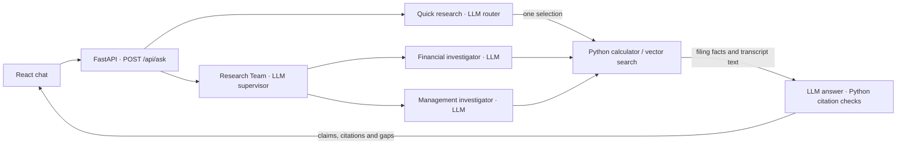

# FinDocRAGAgents

The first runnable slice compares two Infosys quarters using reported consolidated Ind AS figures and returns the inputs, formula, and source coordinates. Run it from the project folder with Python 3.10 or newer.

```powershell
python -m findoc.compare data/infosys-q4-fy26.json revenue 2026-03-31
python -m findoc.compare data/infosys-q4-fy26.json owners-profit 2026-03-31
python -m unittest discover -s tests -v
```

## Read the code in this order

The live demo covers Infosys (INFY). The UI offers four quarter ends for financial questions, and transcript search covers December 2024 and December 2025. The September 2025 snapshot is retained as source data for a future comparison. The chat currently does not select it.



### 1. Start at the browser and follow the request

| File | Read this to understand |
| --- | --- |
| [web/index.html](web/index.html) | The page shell, browser tab icon, and JavaScript entry point. Vite copies the icon from [web/public](web/public) into the production build. |
| [web/src/main.tsx](web/src/main.tsx) | How React mounts the page and places chat alongside the architecture section. |
| [web/src/ResearchChat.tsx](web/src/ResearchChat.tsx) | Where stock, quarter, mode, question, turn history, and selected evidence live. Read the form handler to see where the browser serializes the request. Example buttons fill the composer so you can edit the question before submitting. |
| [web/src/ResearchMode.tsx](web/src/ResearchMode.tsx) and [web/src/Architecture.tsx](web/src/Architecture.tsx) | How the mode control is shared with the architecture diagram. The diagram's control changes the diagram locally. |
| [web/src/researchTypes.ts](web/src/researchTypes.ts) | The response fields read by the browser, including the three shapes of evidence. FastAPI validates the request with its own Pydantic classes. |
| [web/src/ResearchAnswer.tsx](web/src/ResearchAnswer.tsx) and [web/src/EvidencePanel.tsx](web/src/EvidencePanel.tsx) | How claims, gaps, and the workflow trace render. Each answer starts its labels at S1, so the citation target includes the turn number. The source panel displays browser links from the selected answer. |
| [findoc/api.py](findoc/api.py) | The GET /api/config and POST /api/ask routes. Read Question, then run_question. The latter selects the model and workflow and returns that invocation's result. The same server serves the compiled React build. |

The request below asks a follow-up. A blank reporting-quarter dropdown sends null so the workflow can infer the quarter. Choosing a quarter supplies a hint that the backend enforces before running tools.

```json
{
  "symbol": "INFY",
  "period_end": null,
  "mode": "team",
  "question": "What about profit for the same quarter?",
  "history": [{
    "question": "How did revenue change year over year in December 2025?",
    "answer": "Revenue grew 8.90% year over year.",
    "period_end": "2025-12-31"
  }]
}
```

The response contains status, claims with source_ids, the sources keyed by ID, and any known gaps. Read route in Quick research or assignment, financial_tools, and transcript_searches in Research Team to see which paths executed.

### 2. Follow the agents, model calls, and tools

| Stage | Code and inputs | Output and execution |
| --- | --- | --- |
| Quick research | [research.py](findoc/research.py) sends the question, known quarters, explicit quarter hint, and history to an LLM. | A Route with a quarter, optional year-over-year metric, and optional transcript query. LangGraph runs the requested tools once. |
| Research Team supervisor | [supervisor.py](findoc/supervisor.py) sends the same categories of input to the supervisor prompt. | An Assignment with a quarter and up to two specialist tasks. Python checks the period, and LangGraph starts the selected branches. Both branches feed one answer step. |
| Financial investigator | [financial_agent.py](findoc/financial_agent.py) gives the LLM its assigned task, quarter, and the results of tools it already called. | At most three planning iterations. Python runs the selected reported_fact or compare_yoy tool, stops on a repeated action, and records evidence or a gap. The model can also stop explicitly. |
| Management investigator | [investigate.py](findoc/investigate.py) runs an initial vector search. Its follow-up prompt includes the assignment, previous searches, and returned passages. | The LLM can ask for up to two distinct follow-up searches in the same transcript. Python enforces the limit and deduplicates passages. The specialist covers management commentary. |
| Answer | [answer.py](findoc/answer.py) sends the question, quarter, bounded history, labeled current evidence, and known gaps to the LLM. | The LLM returns structured claims and source IDs. Python maps IDs to real filing rows or PDF pages, rejects unknown labels, and skips generation if there is no evidence. The citation check verifies the link between an ID and a retrieved source. Human inspection can check whether a passage supports the wording of the claim. |
| Model provider | [models.py](findoc/models.py) builds the chat client. | The public app uses Groq's GPT-OSS 20B for all the language roles. Each role has a separate prompt and Pydantic output schema. The web app also supports an OpenAI provider. The client uses a 30-second timeout and one retry. |

A Pydantic model such as Assignment is a **schema** that describes the response fields. GPT-OSS is the **language model** that decides what values go in those fields. LangGraph runs nodes and edges, which in turn call either an LLM or a Python tool. A tool is a bounded operation with arguments and a result. The calculator uses Decimal arithmetic. Vector search uses an embedding model plus database similarity search. The browser renders the returned JSON.

### 3. Follow the two data paths

**Filings and calculations.** Read [ingest.py](findoc/ingest.py), [the snapshots](data), and [compare.py](findoc/compare.py). The ingestion command uses Python's HTML parser to find the expected table, match dates and units, and compare extracted facts with reviewed references. Snapshots store rupee amounts in crore with filing URLs, rows, and dates. A date window distinguishes a three-month quarter from an annual or year-to-date statement ending on the same date. The financial tool loads the configured snapshots, locates the current and prior-year values, and computes (current − prior) / prior × 100. The calculation citation preserves both input rows. This path uses the JSON files and Python, without vector retrieval.

**Transcripts and RAG.** RAG means retrieval-augmented generation. Here the application looks up passages before asking the language model to answer. [tools/transcripts.py](findoc/tools/transcripts.py) is shared by the keyword and vector indexers. It uses Poppler to extract the PDF, checks the expected call title and layout, strips boilerplate, and preserves physical PDF pages and printed transcript page numbers. [seed.py](findoc/seed.py) downloads the two configured NSE PDFs into a temporary directory and invokes the vector indexing command.

1. [vector.py](findoc/vector.py) splits each page into windows of up to 140 words with 30 words of overlap. Keeping passages inside a page makes each PDF link precise.
2. FastEmbed runs BAAI/bge-small-en-v1.5 on the VPS CPU. The embedding library handles tokenization internally. Token IDs represent text pieces while the model is processing them. The model produces one vector of 384 numbers for the whole passage. PostgreSQL stores that vector alongside the readable passage and provenance.
3. LangChain Postgres sets up and queries transcript_vectors. Indexing uses a PostgreSQL transaction to replace the rows for one quarter and embedding version. Each row has the company, quarter, index version, original content, vector, PDF page, passage number, printed transcript page, source URL, and source file hash.
4. On a question, Python embeds the transcript query with the matching model. PostgreSQL uses pgvector to rank passages by cosine distance, filtered by company, quarter, and index version. The code keeps the best passage per page and can widen the candidate set to return up to five distinct pages per live search.
5. The answer prompt receives readable passage text labeled S1, S2, and so on. PostgreSQL provides the matched text, and Python keeps the original link for each label. Document embeddings are computed at indexing time. Only the query needs a new embedding during search.

Read [baseline/keyword.py](findoc/baseline/keyword.py) for the SQLite FTS5 and BM25 path. [evidence.py](findoc/evidence.py) exposes its original CLI. [baseline/evaluate.py](findoc/baseline/evaluate.py) compares page retrieval with the [retrieval smoke cases](data/retrieval-smoke.json). [baseline/research_eval.py](findoc/baseline/research_eval.py) exercises routed answers with the [research smoke cases](data/research-smoke.json). The live transcript path uses vector search. Comparing keyword and vector search here is a separate exercise.

### 4. See where context lives

| Context | Lifetime and contents |
| --- | --- |
| Browser chat | React keeps the full visible thread for the open page. A request sends the last three turns with claims, each with its question, answer summary of up to 1,200 characters, and resolved quarter. Reload or New chat clears it. Separate visitors have separate in-page state. |
| LangGraph state | One invocation holds the question, context supplied by the browser, route or assignments, tool results, and answer. FastAPI caches the compiled workflow for reuse, but each invocation starts with fresh state. |
| Retrieval index | Persistent PostgreSQL rows derived from the published PDFs. Every visitor searches the same company corpus. User chat does not build or update the index. |
| LLM prompt | Each role sees the inputs in its prompt template. Routing and synthesis use earlier turns to resolve references such as “the same quarter.” Specialists use their current assignment and tool observations. Fresh evidence from the current run supports the answer. |

### 5. Map the code to the running site

[Dockerfile](Dockerfile) builds the React bundle and packages it with the Python application. Caddy on the DigitalOcean VPS terminates HTTPS and proxies to FastAPI. FastAPI calls Groq for generation. BGE runs in the FastAPI process and reuses a cache mounted on the VPS. A read-only application role searches the FinDoc database in the shared PostgreSQL instance. The filing JSON ships with the app. Use [the deployment runbook](deploy/README.md) to trace the container, runtime configuration, check commands, and rollback.

### Next steps for learning

1. **Trace a request in the browser.** Open DevTools → Network, choose Quick research, and ask the December 2025 revenue-growth question. Read the POST JSON, then match the returned route, calculation, claims, and source IDs to the UI.
2. **Run each tool in isolation.** Run compare.py against the March snapshot. Use the Step 4 vector search for the labor-code question and open the cited PDF page. Look at the query, distance, returned text, and source fields in the terminal output.
3. **Watch the supervisor delegate.** Use Research Team and ask the combined question from **Try a question**. Open **How this answer was researched** and match the assignments, tool names, and PDF pages to the backend graph nodes.
4. **Trace conversational context.** Ask “What about profit for the same quarter?” with the quarter set to **Infer from chat**. Inspect the next request's history alongside the fresh filing citation, then use **New chat** and repeat to see how missing context changes the route.
5. **Make the workflow inspectable.** Add development-only timing for routing, each specialist, retrieval, and synthesis. Use the trace to explain which operations run on the VPS and which wait for Groq. After that, a second company is a good exercise in configuring stock and quarter metadata end to end.


## Step 1. Trace a number back to the filing

1. Open the detailed consolidated audited statement and find the **Revenue from operations** row. Match the March 2026 and March 2025 **quarter** columns. The year column can have the same end date, so record both dates. [Infosys filing on EDGAR](https://www.sec.gov/Archives/edgar/data/1067491/000106749126000018/exv99w06.htm)
2. Inspect the four manually transcribed values in [the snapshot](data/infosys-q4-fy26.json). Consolidated figures cover Infosys and its subsidiaries. A crore is ten million. Profit attributable to owners excludes the portion attributable to non-controlling interests.
3. Run the comparison. Revenue went from INR 40,925 crore to INR 46,402 crore. The difference is INR 5,477 crore. Divide the difference by the earlier value to get 13.38% growth. Decimal arithmetic and explicit rounding make that result reproducible.
4. Inspect the JSON result. Each input retains its exact period, filing URL, section, and row. Later, agents can call the comparison function and cite its inputs.
5. Run the tests. One fixture adds a full-year number with the same end date and verifies that the calculation still selects the quarter. Other fixtures check missing and duplicate facts and nonpositive percentage baselines.

The manual reference uses prior-year comparatives from the FY2026 statement. Keep it separate from generated data so it can catch extraction errors.

## Step 2. Extract and validate facts from NSE filings

Download local copies of the two consolidated Ind AS filings, then run the parser. Keeping the download separate lets you repeat extraction against the same files. The output command expects a new filename so that reruns preserve previous snapshots.

```powershell
$fy25 = Join-Path $env:TEMP 'findoc-infy-nse25.html'
$fy26 = Join-Path $env:TEMP 'findoc-infy-nse.html'
$out = Join-Path $env:TEMP ('findoc-extracted-' + [guid]::NewGuid() + '.json')
Invoke-WebRequest -ErrorAction Stop -Uri 'https://nsearchives.nseindia.com/corporate/ixbrl/INTEGRATED_FILING_INDAS_85350_17042025233634_iXBRL_WEB.html' -OutFile $fy25
Invoke-WebRequest -ErrorAction Stop -Uri 'https://nsearchives.nseindia.com/corporate/ixbrl/INTEGRATED_FILING_INDAS_152465_23042026210154_iXBRL_WEB.html' -OutFile $fy26
python -m findoc.ingest --fy25 $fy25 --fy26 $fy26 --reference data/infosys-q4-fy26.json --output $out
python -m findoc.compare $out revenue 2026-03-31
python -m findoc.compare $out owners-profit 2026-03-31
```

1. **Read the filing as tables.** The structured HTML preserves cell boundaries and metadata. The parser identifies the Infosys filing and the table containing both target metrics. The label “Revenue from operations” also appears in a segment table, so a text match alone is ambiguous.
2. **Match the column.** Select January 1 through March 31 and check that the results are consolidated and audited. The annual column also ends on March 31.
3. **Normalize the unit.** FY2025 reports in INR actuals, so divide by 10,000,000. FY2026 reports in INR lakh, so divide by 100. Both produce INR crore. For example, FY2026 revenue of 46,40,200 lakh becomes 46,402 crore. [FY2025 filing](https://nsearchives.nseindia.com/corporate/ixbrl/INTEGRATED_FILING_INDAS_85350_17042025233634_iXBRL_WEB.html), [FY2026 filing](https://nsearchives.nseindia.com/corporate/ixbrl/INTEGRATED_FILING_INDAS_152465_23042026210154_iXBRL_WEB.html)
4. **Keep the evidence.** Each fact carries the raw value, unit, source URL, table/row/cell positions, and SHA-256 of the downloaded file. The hash identifies the exact file used.
5. **Validate before writing.** The command checks all four metric/period/value combinations against the manual reference. The existing comparison then returns 13.38% revenue growth and 20.87% profit growth.

### Extend the check to Q3 FY2026

Reuse the `$fy25` and `$fy26` downloads from above. The December filing puts a three-month quarter next to a nine-month year-to-date total. Both columns end on December 31. Checking for a start date of October 1 distinguishes the quarter from the year-to-date total starting April 1.

```powershell
$q3 = Join-Path $env:TEMP 'findoc-infy-q3-fy26.html'
$out = Join-Path $env:TEMP ('findoc-three-quarters-' + [guid]::NewGuid() + '.json')
Invoke-WebRequest -ErrorAction Stop -Uri 'https://nsearchives.nseindia.com/corporate/ixbrl/INTEGRATED_FILING_INDAS_135037_14012026203832_iXBRL_WEB.html' -OutFile $q3
python -m findoc.ingest --fy25 $fy25 --fy26 $fy26 --q3-fy26 $q3 --reference data/infosys-q4-fy26.json --reference data/infosys-q3-fy26.json --output $out
(Get-Content -Raw $out | ConvertFrom-Json).facts | Format-Table metric, start, end, value
```

Expect six facts across the three quarters. The two December values, revenue of INR 45,479 crore and profit attributable to owners of INR 6,654 crore, were checked against the separately published consolidated audited statement. The parser now keys source configuration by quarter-end date. This keeps December 2025 and March 2025 distinct even though both dates share a calendar year. [Infosys Q3 FY2026 audited results](https://www.infosys.com/investors/reports-filings/quarterly-results/2025-2026/q3/documents/q3-and-9m-fy26-financial-results-auditorsreports.pdf)

The HTML parser covers these three configured Infosys filings and two metrics. The research workflow supplements the extracted coverage with a separate December 2024 reference snapshot checked against the audited result and the following year's comparative column. [Infosys Q3 FY2025 audited results](https://www.infosys.com/investors/reports-filings/quarterly-results/2024-2025/q3/documents/q3-and-9m-fy25-financial-results-auditorsreports.pdf)

## Step 3. Search narrative evidence

Use Python with SQLite FTS5 and install Poppler's `pdftotext` on your PATH. Download the exchange filing to a local temporary folder and build an index. The same database can then serve multiple searches.

```powershell
$pdf = Join-Path $env:TEMP 'findoc-infy-q3-nse-transcripts.pdf'
$db = Join-Path $env:TEMP 'findoc-infy-q3-evidence.sqlite3'
Invoke-WebRequest -ErrorAction Stop -Uri 'https://nsearchives.nseindia.com/corporate/Infosys_19012026222220_SEfiling_Earningscalltranscript_19012026.pdf' -OutFile $pdf
python -m findoc.evidence index $pdf $db
python -m findoc.evidence search $db 'labor codes operating margins'
```

1. **Extract one entry per page.** Poppler inserts a page break between pages. The NSE PDF includes a cover letter and press conference before the earnings call. The parser checks the expected layout and indexes the 21 call pages after the roster.
2. **Build a keyword baseline.** SQLite FTS5 indexes the page text and applies stemming so that related forms such as “margin” and “margins” can match. Every query term must match. BM25 ranks the matching pages using term frequency, rarity, and page length. This baseline lets us measure retrieval before adding embeddings.
3. **Read the first result.** The query returns PDF page 21 first. It is printed page 4 of the call. The CFO describes reported operating margin of 18.4% and adjusted margin of 21.2% after excluding the impact of the labor-code change. Operating margin measures operating profit as a share of revenue. [NSE transcript, PDF page 21](https://nsearchives.nseindia.com/corporate/Infosys_19012026222220_SEfiling_Earningscalltranscript_19012026.pdf#page=21)
4. **Try a query with no evidence.** Search for `quantum giraffe` and expect an empty list. A later answer layer can use this to recognize a retrieval miss.

### Add the corresponding FY2025 call

The January 2025 call covers the quarter ended December 31, 2024. Add it to the same database so both calls can be searched. Reindexing replaces only the selected call.

```powershell
$priorPdf = Join-Path $env:TEMP 'findoc-infy-q3-fy25-call.pdf'
Invoke-WebRequest -ErrorAction Stop -Uri 'https://nsearchives.nseindia.com/corporate/Infosys_21012025151633_SEfiling_Earningscalltranscript.pdf' -OutFile $priorPdf
python -m findoc.evidence index $priorPdf $db
python -m findoc.evidence search $db 'operating margins expanded' --period-end 2024-12-31
python -m findoc.evidence search $db 'labor codes operating margins' --period-end 2025-12-31
```

The earlier call has 23 searchable pages. Its first query returns the reported 21.3% operating margin on printed page 5, PDF page 25. The later call has 21 searchable pages. Filter by the quarter end when comparing periods, and identify whether each measure is reported or adjusted. [FY2025 transcript, PDF page 25](https://nsearchives.nseindia.com/corporate/Infosys_21012025151633_SEfiling_Earningscalltranscript.pdf#page=25)

The index returns page citations and short snippets for both transcripts. It serves as our keyword baseline.

## Step 4. Embed the transcripts and compare retrieval

1. **Split each page into passages.** The vector command reuses the PDF extraction above and groups words into passages of up to 140 words, with a 30-word overlap so nearby context can survive a boundary. Each passage stays on one page so the citation stays precise.
2. **Create embeddings locally.** FastEmbed runs the BGE Small English model on the CPU. The first run downloads model files. Subsequent runs can use the local cache. The model turns each passage into 384 numbers and uses the corresponding query encoding when a question arrives. [BGE model card](https://huggingface.co/BAAI/bge-small-en-v1.5)
3. **Store and search the vectors.** LangChain's `PGVectorStore` sets up the PostgreSQL table and handles ranked search through pgvector. PostgreSQL stores the passage, quarter, page, source link, file hash, and vector. We keep the best passage per page for comparison with SQLite's page-level results. Reindexing a quarter uses a single transaction so a failed insert preserves the previous data. [LangChain Postgres integration](https://github.com/langchain-ai/langchain-postgres#vectorstore), [pgvector documentation](https://github.com/pgvector/pgvector)
4. **Compare the same queries.** The evaluation runs four hand-labeled queries through both paths with the same period filter. A hit means the expected page appears in the first three results. This checks the pipeline on two transcripts. A larger held-out set with multiple acceptable pages is needed to evaluate retrieval quality.

Install the vector dependencies in the project environment. Set `FINDOC_DATABASE_URL` to a PostgreSQL database with the pgvector extension available. The indexing role needs permission to create the extension and table, or an administrator can install the extension first. Use the two transcript PDFs and keyword database from Step 3.

If you built the original SQL-based vector index, rerun the indexing command below. The new integration writes to `transcript_vectors` and leaves the original `transcript_passages` table available.

```powershell
uv venv .venv
uv pip install -r requirements-vector.txt
# Set FINDOC_DATABASE_URL in this shell before running the commands.
.\.venv\Scripts\python.exe -m findoc.vector index $priorPdf $pdf
.\.venv\Scripts\python.exe -m findoc.vector search 'How did new employment rules affect profitability?' --period-end 2025-12-31
.\.venv\Scripts\python.exe -m findoc.vector evaluate $db data/retrieval-smoke.json
```

For this implementation check, the Python client connected to a temporary local PGlite PostgreSQL instance with pgvector. The planned application deployment uses a regular PostgreSQL server. [PGlite extensions](https://pglite.dev/extensions/)

The run stored 153 passages. Keyword search found the expected page in the top three for two of the four queries. Vector search found it for all four. The two paraphrases were misses for the current keyword command because it requires every input term. The employment-rules question returned the expected page second with vectors. This is a smoke test against known pages, so the results describe these four queries only.

## Build and learning sequence

The code follows these paths:

| Location | Responsibility |
|---|---|
| [`findoc/tools/transcripts.py`](findoc/tools/transcripts.py) | Shared PDF extraction and source page metadata used by both retrieval methods |
| [`findoc/baseline/`](findoc/baseline) | SQLite keyword search and evaluation against expected pages |
| [`findoc/vector.py`](findoc/vector.py) | Embedding and vector retrieval for the answer workflow |
| [`findoc/answer.py`](findoc/answer.py) | Passes retrieved evidence to the answer model and resolves its citations |

The original `findoc.evidence` command still opens the keyword baseline. Running vector indexing or search only loads the shared transcript reader. The `evaluate` subcommand calls both search methods. The financial calculator remains in [`findoc/compare.py`](findoc/compare.py) for the future answer workflow to call when it needs arithmetic.

| Step | Build | What we check before moving on |
|---|---|---|
| 1 | Cited Infosys comparison | Values reconcile to the filing and period matching handles an annual column |
| 2 | Source inventory and automated ingestion for one company | First slice verified on three Infosys filings, including a quarter with a nine-month comparative column |
| 3 | Narrative retrieval and cited single-agent Q&A | Compare keyword and vector retrieval on the same pages, then evaluate generated answers and citations |
| 4 | Expand across the five companies and eight quarters | Check data coverage, revised comparatives, and consistent scope/units |
| 5 | Add specialists and independent verification | Compare against the single-agent baseline on the same questions and similar budgets |
| 6 | Integrate real market data and benchmarks | Verify data-use rights, trading dates, corporate actions, and return conventions |
| 7 | Deploy the public demo | Verify citation navigation, live Q&A, briefs, chart accuracy, and recovery |

At each step, start with a worked example, implement it, measure the result, and use the observed failures to choose the next improvement. [Full project plan](PROJECT_PLAN.md)

## Step 5. Generate a cited answer

1. **Retrieve.** Reuse the indexed PostgreSQL database to get up to three pages from the requested quarter.
2. **Add the passages to the prompt.** Python gives each passage a short label, such as `S1`, and includes its text in the prompt.
3. **Generate and resolve citations.** The model returns structured claims with source labels or reports insufficient evidence. Python checks that each label came from the retrieved set and attaches the original page URL. This catches invented labels. A separate evaluation must check whether the cited text actually supports each claim. [OpenAI Structured Outputs](https://developers.openai.com/api/docs/guides/structured-outputs)

The default answer model is `gpt-5.6-terra`. Use `--model` to select another model available to your API project that supports Structured Outputs. This command sends the question and retrieved text to the OpenAI API. Set `OPENAI_API_KEY` in your environment or the ignored `.env` file at the project root. Existing environment variables take precedence. [Model documentation](https://developers.openai.com/api/docs/models/gpt-5.6-terra), [API key setup](https://developers.openai.com/api/docs/quickstart#create-and-export-an-api-key)

```powershell
uv pip install -r requirements-answer.txt
# Configure FINDOC_DATABASE_URL and OPENAI_API_KEY in your environment.
.\.venv\Scripts\python.exe -m findoc.answer 'How did new employment rules affect profitability?' --period-end 2025-12-31
.\.venv\Scripts\python.exe -m unittest discover -s tests -v
```

The tests use a simulated model response and do not need an API key. The transcript answer command covers earnings-call evidence for one quarter.

## Step 6. Explain a verified calculation

Use the same answer command with a snapshot and metric. The calculation path reads the JSON file directly and needs no vector database.

```powershell
.\.venv\Scripts\python.exe -m findoc.answer 'How much did Infosys revenue grow year over year?' --period-end 2026-03-31 --snapshot data/infosys-q4-fy26.json --metric revenue
```

Python selects the two reported quarter values, calculates the change using decimal arithmetic, and supplies the result to the model. A calculation citation attaches the two filing references, including the row and reporting period for each input. The command also returns the verified calculation as a separate JSON field. A missing quarter produces an insufficient-evidence result with the missing period and skips the model call. The explicit snapshot and metric options let you exercise the calculation by itself.

## Step 7. Let a routing agent choose the tools

The agent returns a structured decision about the quarter, calculator metric, and a focused transcript query when search is needed. LangGraph runs the selected tools and brings their evidence together for one cited answer. A calculation-only question uses the local snapshot. Transcript search uses the vector database from Step 4. If the question requests both and one source is missing, the result reports the gap and can answer the supported portion. [LangGraph Graph API](https://docs.langchain.com/oss/python/langgraph/graph-api)

```powershell
uv pip install -r requirements-research.txt
.\.venv\Scripts\python.exe -m findoc.research 'How much did Infosys revenue grow year over year in the March 2026 quarter?'
.\.venv\Scripts\python.exe -m findoc.research 'What did Infosys management say about the labor-code impact on operating margins in December 2025?'
.\.venv\Scripts\python.exe -m findoc.research 'How much did Infosys revenue grow year over year in December 2025, and what did management say about the labor-code effect on margins?'
```

Read the `route` field to see what the agent selected and `gaps` to see what the tools could not provide. The third question exercises both branches and should cite the December revenue calculation and the CFO's margin explanation separately. Use `--period-end` when you want to specify the quarter yourself.

### Save the routing and citation baseline

Run the three [research smoke cases](data/research-smoke.json) against the indexed transcript and the live model:

```powershell
.\.venv\Scripts\python.exe -m findoc.baseline.research_eval
```

The cases cover a two-tool answer, a missing December 2023 comparative, and a question with no reporting period. The checks compare the route and status, verify the deterministic numbers, and confirm that expected claims cite the right type of evidence or page. The report also lists retrieved pages, which helps distinguish a retrieval miss from an answer that overlooked available evidence. The routed workflow supplies up to five transcript pages. In the first combined run, the expected page ranked fifth and fell outside the initial three-page limit. Each case has a review note for checking context and causality by hand. These are focused regression checks.

## Step 8. Investigate a management claim

The transcript investigator searches the selected call, reads the returned passages, and decides whether a more focused search would help. It can run up to two follow-up searches. Then it uses the same cited answer function. Look at the `searches` field to see the query, evidence sought, and pages returned at each step.

```powershell
.\.venv\Scripts\python.exe -m findoc.investigate 'What did Infosys management say about the labor-code impact on reported operating margin, and what adjusted free cash flow and conversion did it report?' --period-end 2025-12-31
```

Use the same indexed transcript and API settings as Step 7. The evidence scope is the earnings call, so the result describes management's statements and their qualifications. It does not independently check the filing.

## Step 9. Delegate to two specialists

The supervisor assigns a question to the financial investigator, the management investigator, or both. The financial investigator can make up to three reported-fact or year-over-year calculation calls. The management investigator uses the transcript search from Step 8 with up to two follow-ups. When both are selected, LangGraph runs them independently and passes the combined evidence to the cited answer step once.

```powershell
.\.venv\Scripts\python.exe -m findoc.supervisor 'How did Infosys revenue and profit attributable to owners change year over year in the December 2025 quarter, and how did management explain the labor-code impact on margin?'
```

The result uses the existing `status`, `claims`, and `sources` fields. It adds `assignment`, `financial_tools`, `transcript_searches`, and `gaps` for inspection. The current baseline uses the same configurable answer model for the supervisor, both specialists, and the answer step.

## Step 10. Open the web research workspace

The React interface calls the FastAPI server on the same origin. The API runs the existing single-router or supervisor workflow and returns claims, links, evidence gaps, and the selected research steps. The browser receives no model credentials.

```powershell
uv pip install -r requirements-web.txt
npm.cmd ci --prefix web
npm.cmd run build --prefix web
.\.venv\Scripts\python.exe -m uvicorn findoc.api:app --host 127.0.0.1 --port 8000
```

Open [the local research workspace](http://127.0.0.1:8000). The server reads `OPENAI_API_KEY` and `FINDOC_DATABASE_URL` from the environment or the ignored project `.env`. Questions that need transcript evidence require a running, indexed pgvector database. Financial calculations can use the local snapshots with no database connection. Keep both settings server-side.

For UI development, leave FastAPI running and run `npm.cmd run dev --prefix web` in a second terminal. Vite proxies API requests to the local FastAPI server. The production build can be served by FastAPI directly. Deploying that build to staging still requires a database with the corpus indexed and server-side credentials. [FastAPI static serving](https://fastapi.tiangolo.com/tutorial/static-files/), [Vite dev proxy](https://vite.dev/config/server-options#server-proxy)

### Try Groq from the local UI

Set `FINDOC_MODEL_PROVIDER=groq` and `GROQ_API_KEY` in the ignored `.env`, then restart FastAPI. The web app defaults to GPT-OSS 20B in Groq mode. If you previously set `FINDOC_ANSWER_MODEL`, clear the override or use a model ID available on Groq that supports strict structured outputs. Keep the indexed `FINDOC_DATABASE_URL` configured for transcript searches. [Groq API keys](https://console.groq.com/keys) · [Groq structured outputs](https://console.groq.com/docs/structured-outputs)

Select **Research Team** and ask how Infosys revenue changed year over year in December 2025 and what management said about the labor-code impact on margins. FastAPI sends the model calls to Groq. LangGraph, the calculator, and the embedding search run through the local backend. Set `FINDOC_MODEL_PROVIDER=openai` to use the OpenAI baseline in the web app.

### Run embedding inference through a hosted API

Set `FINDOC_EMBEDDING_PROVIDER=openai` with `OPENAI_API_KEY` to use `text-embedding-3-small` for both indexing and search. Reindex the two transcripts under that configuration, then start FastAPI with the same setting. The hosted index has its own version, so searches use embeddings from the selected model. PostgreSQL still stores the vectors and computes similarity on the app's database server. The default local mode uses FastEmbed for the BGE retrieval baseline. [OpenAI embedding model](https://developers.openai.com/api/docs/models/text-embedding-3-small)

### Shared PostgreSQL on the DigitalOcean VPS

The VPS runs one PostgreSQL instance with separate Trader and FinDoc databases. FastAPI serves React, calls Groq for generation, and runs BGE embeddings locally through FastEmbed.

FinDoc is reachable at [findoc.manojmathivanan.com](https://findoc.manojmathivanan.com). Cloudflare publishes a DNS-only record to the VPS. Caddy terminates HTTPS and proxies to FastAPI on loopback. The container uses the read-only database account and a persistent BGE model cache. The first hosted Research Team check reached the container's 280 MiB memory limit without restarting. Concurrent research capacity has not been measured.

The [PostgreSQL Dockerfile](deploy/postgres/Dockerfile) adds pgvector to the exact Alpine image used by Trader. Download the [pgvector source archive](https://codeload.github.com/pgvector/pgvector/tar.gz/refs/tags/v0.8.7) as `pgvector.tar.gz` into a temporary build context alongside that Dockerfile. The build verifies the archive checksum before compiling. The compiled extension files are copied into the final image.

Before cutover, preserve the running image and Compose configuration, verify a usable Trader backup, and choose a maintenance window outside scheduled Trader jobs. Swap only the PostgreSQL service image while retaining its existing data mount and settings. Verify PostgreSQL readiness, query Trader's database, and check Trader's application before creating a dedicated FinDoc database. Install pgvector there as an administrator, then index the transcripts with a dedicated indexing role and give the web role read access. If the swap fails, restore the saved image and Compose configuration with the same data mount. Check FastAPI and Trader memory together before publishing the FinDoc UI.
